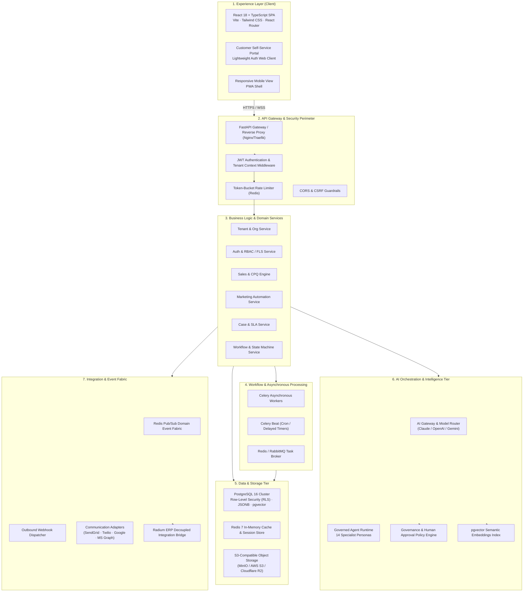

# SYVORIS Ai™ — System Architecture Specification
**Production-Grade Multi-Tenant SaaS Architecture**  
*Document Version: 1.0.0 (Phase 0 Discovery Baseline)*  
*Status: Approved Blueprint*

---

## 1. High-Level Architectural Vision

SYVORIS Ai™ is designed as a modular, API-first, multi-tenant enterprise SaaS platform. The system decouples the presentation client from backend services, business rules, transactional data persistence, workflow execution, and governed AI operations.

---

## 2. Seven-Layer Target Architecture

### Layer 1: Experience Layer (Frontend)
- **Technology:** React 18, TypeScript 5.8, Vite 6, Tailwind CSS 3.4, React Router DOM 6.
- **Responsibilities:**
  - Fast, responsive client-side routing across all 132 business workspaces.
  - State management utilizing React Context and lightweight client caching (TanStack Query / SWR).
  - Rich UI interaction: visual Kanban pipelines, multi-line CPQ quote builder, drag-and-drop workflow designer, and real-time dashboard analytics (Recharts).
  - Client-side token storage (in-memory access tokens with secure HTTP-only refresh cookies).
- **Decoupling Rule:** The frontend performs zero authoritative business validation, pricing calculations, or permission checks. It strictly consumes versioned REST APIs (`/api/v1/*`).

### Layer 2: API Gateway & Security Perimeter
- **Technology:** Python FastAPI (ASGI) behind an Nginx reverse proxy.
- **Responsibilities:**
  - TLS 1.3 termination, HTTP/2 transport, security headers (HSTS, CSP, X-Frame-Options).
  - Cryptographic JWT verification and tenant extraction on every authenticated request.
  - Distributed rate limiting per tenant tier using Redis token-bucket algorithms.
  - Global request validation using strict Pydantic v2 schemas.
  - Standardized error serialization following RFC 7807 (Problem Details for HTTP APIs).

### Layer 3: Business Logic & Domain Services Layer
- **Architecture:** Modular Monolith with clean hexagonal architecture (Ports and Adapters).
- **Core Modules:**
  1. `tenancy`: Tenant onboarding, subscription plans, feature flags, usage quotas.
  2. `identity`: Users, password hashing (Argon2id), MFA (TOTP), roles, field-level permissions.
  3. `crm_core`: Organizations, contacts, relationships, customer 360 aggregation.
  4. `sales_cpq`: Leads, scoring, qualification, conversion, pipelines, price books, quotes, orders.
  5. `marketing`: Campaigns, segments, journeys, email templates, engagement tracking.
  6. `support`: Cases, support queues, SLA timers, business hours, knowledge base.
  7. `workflows`: State machine transitions, visual rules, multi-stage approval engine.
  8. `audit`: Append-only immutable change ledger and compliance exports.

### Layer 4: Workflow & Asynchronous Processing Engine
- **Technology:** Celery 5.4 with Redis 7 as broker and result backend.
- **Responsibilities:**
  - Heavy, non-blocking background tasks: PDF generation, bulk CSV import/export parsing.
  - Time-delayed and scheduled jobs: Celery Beat for SLA breach monitoring, scheduled campaign dispatches, and periodic forecast rollups.
  - Resilience: Automatic retry with jittered exponential backoff for transient failures; Dead-Letter Queue (DLQ) for permanent exceptions.

### Layer 5: Data & Storage Tier
- **Relational Database:** PostgreSQL 16.
  - Native multi-tenant isolation via Row-Level Security (RLS) policies.
  - Extensible custom fields using PostgreSQL `JSONB` with JSON schema validation.
  - High-performance text searching via `tsvector` and trigram matching (`pg_trgm`).
  - Vector similarity embeddings managed directly in PostgreSQL via the `pgvector` extension.
- **In-Memory Cache:** Redis 7 for user session states, fast aggregate counters, and rate limiting.
- **Object Storage:** S3-compatible object storage (AWS S3, Cloudflare R2, or local MinIO) for commercial quote PDFs, customer contracts, case attachments, and communication audio recordings.

### Layer 6: AI Orchestration & Governed Intelligence
- **Technology:** Python-based AI Gateway layer (LiteLLM / LangChain / direct provider SDKs).
- **Responsibilities:**
  - Multi-provider LLM routing across Anthropic (Claude 3.5 Sonnet), OpenAI (GPT-4o), and Google (Gemini 1.5 Pro).
  - Grounded RAG pipelines retrieving tenant-scoped records via `pgvector` embeddings.
  - Execution runtime for the 14 specialist agent personas.
  - **Governance & Policy Engine:** Enforces the three-tier autonomy model (`Suggest Only`, `Act with Approval`, `Act Autonomously`). Prevents unauthorized writes and stages high-risk proposals in the human approval queue.

### Layer 7: Integration & Event Fabric
- **Technology:** Redis Pub/Sub domain event bus and asynchronous webhook dispatchers.
- **Responsibilities:**
  - Decoupled domain event broadcasting (`lead.created`, `deal.won`, `case.escalated`, `quote.approved`).
  - External communication gateways: SendGrid/Amazon SES (Email), Twilio (SMS/Voice), Google Workspace / Microsoft Graph (Calendar & Email Sync).
  - **Radium ERP Connector Boundary:** Loosely coupled REST/webhook adapter. Synchronizes master product catalogs, queries inventory stock balances, exports accepted sales orders, and ingests invoice payment updates without shared database dependencies.

---

## 3. Technology Evaluation & Selection Rationale

| Layer | Selected Technology | Alternative Considered | Selection Rationale |
|---|---|---|---|
| **Frontend** | React 18 + TypeScript + Vite | Next.js / Angular | Retains the entire 132-route existing SYVORIS application, ensuring 100% UI asset reuse, rapid Vite HMR builds, and zero frontend redesign overhead. |
| **Backend Framework** | Python FastAPI (ASGI) | Django REST Framework / Node.js Express | FastAPI provides high-performance asynchronous execution, native OpenAPI 3.1 generation, strict Pydantic v2 data validation, and first-class native integration with AI/ML toolchains and agent runtimes. |
| **Primary Database** | PostgreSQL 16 | MySQL 8 / MongoDB | PostgreSQL is the gold standard for multi-tenant SaaS due to native Row-Level Security (RLS), ACID transactions, advanced indexing (`pg_trgm`, `tsvector`), `JSONB` for custom fields, and `pgvector` for unified AI embeddings. |
| **Caching & Messaging**| Redis 7 | RabbitMQ / Kafka | Redis serves as a unified, ultra-low-latency solution for session caching, rate limiting, Celery task queuing, and lightweight domain event pub/sub without the operational complexity of Kafka. |
| **Asynchronous Queue** | Celery + Celery Beat | BullMQ / Temporal | Native Python integration with FastAPI; robust scheduling; comprehensive retry semantics and mature operational tooling for enterprise job execution. |
| **Object Storage** | S3-Compatible API (MinIO/S3) | Local Filesystem / GridFS | Cloud-agnostic, infinitely scalable document and attachment storage supporting presigned URLs, encryption at rest, and lifecycle retention policies. |

---

## 4. Architectural Boundaries & Decoupling Guardrails

1. **Radium ERP Decoupling:**
   - SYVORIS Ai and Radium ERP maintain completely separate database engines, database schemas, and authentication providers.
   - All inter-system communication occurs via authenticated, versioned REST APIs or signed webhook events.
   - SYVORIS Ai remains 100% operational as a standalone CRM even if Radium ERP is offline or disconnected.
2. **Business Logic Ownership:**
   - Client components are strictly presentational. No commercial calculations, pricing rules, permission checks, or sequence number increments may occur in browser JavaScript.
   - All state mutations must be validated and executed by the backend API.
3. **Audit Immutability:**
   - Audit records and decision logs are append-only. No API endpoint or database trigger may permit `UPDATE` or `DELETE` operations on `audit_ledger` tables.
