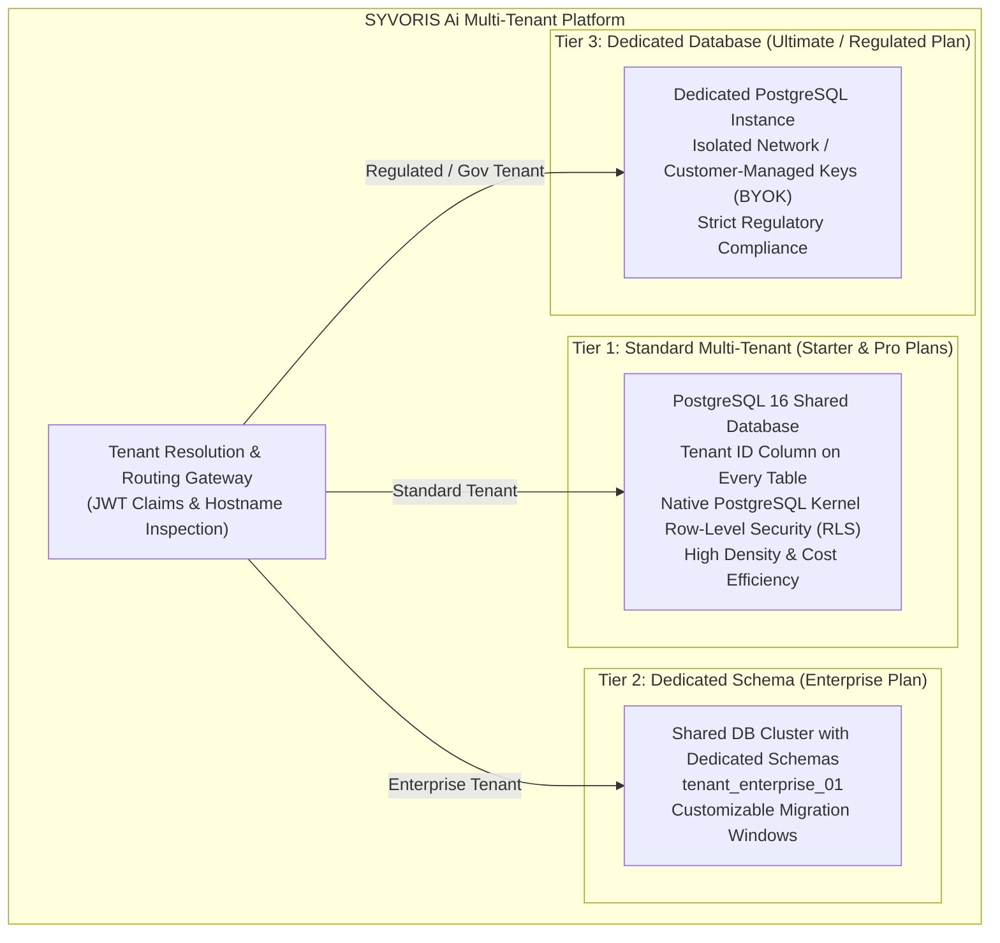
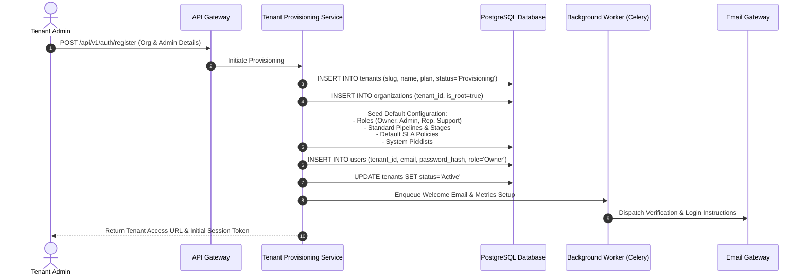

# SYVORIS Ai™ — Multi-Tenant SaaS Architecture & Isolation Strategy
**Enterprise Tenancy Model, Security Boundaries, and PostgreSQL RLS Architecture**  
*Document Version: 1.0.0 (Phase 0 Discovery Baseline)*  
*Status: Approved Blueprint*

---

## 1. Executive Tenancy Mandate

In SYVORIS Ai™, multi-tenancy is a first-class architectural requirement, not an optional feature or retrofitted layer. The platform must securely support hundreds to thousands of independent business enterprises on shared cloud infrastructure without any possibility of cross-tenant record leakage, unauthorized modifications, or noisy-neighbor resource starvation.

Every tenant organization must have an independent, sovereign operational partition encompassing its own:
- Organization master profile and branding
- Users, teams, hierarchies, and security roles
- Accounts, contacts, leads, and customer 360 memory
- Sales pipelines, opportunity stages, playbooks, and quotas
- Marketing campaigns, audience segments, and email templates
- Support queues, SLA policies, and business hours calendars
- Product catalogs, price books, quotes, orders, and invoices
- Visual automation workflows and approval rules
- Custom fields, picklists, and UI layout metadata
- AI agent autonomy settings, governance policies, and audit logs
- Subscriptions, feature entitlements, and billing ledgers

---

## 2. PostgreSQL Multi-Tenancy Strategy Evaluation

We evaluate the three standard PostgreSQL multi-tenant architecture patterns for enterprise SaaS:

### Pattern A: Shared Database, Shared Schema with PostgreSQL Row-Level Security (RLS)
- **Mechanism:** All tenant records reside in shared tables (e.g., `organizations`, `deals`). Every tenant table contains a mandatory non-nullable `tenant_id UUID` column. PostgreSQL native Row-Level Security (`ENABLE ROW LEVEL SECURITY`) enforces query filtering at the database kernel level based on the current session parameter `app.current_tenant_id`.
- **Pros:**
  - Optimal resource utilization and lowest cost per tenant.
  - Single database schema migration applies instantly to all tenants.
  - Connection pooling (e.g., PgBouncer) operates with maximum efficiency.
  - Straightforward cross-tenant aggregate analytics for SaaS platform operators.
- **Cons:**
  - Requires rigorous RLS policy authoring and disciplined session variable injection.
  - Per-tenant point-in-time restore requires logical table-level extraction.
  - Potential noisy-neighbor query performance impact if large tenants are unindexed.

### Pattern B: Shared Database, Separate Schema per Tenant (Schema-per-Tenant)
- **Mechanism:** A single PostgreSQL database contains multiple namespaces (`tenant_a`, `tenant_b`, etc.). Database connections set the `search_path` dynamically (`SET search_path TO tenant_a, public`).
- **Pros:**
  - Strong logical separation; tables belong entirely to one tenant.
  - Easy per-tenant data export and table drop on tenant churn.
- **Cons:**
  - Schema migrations must be run sequentially across thousands of schemas, creating migration bottlenecks and failure points.
  - PostgreSQL metadata and catalog bloat (shared buffer exhaustion) when tenant count exceeds ~500–1,000 schemas.
  - Connection pooling becomes complex when switching `search_path`.

### Pattern C: Separate Database per Tenant (Database-per-Tenant)
- **Mechanism:** Every tenant operates on a dedicated PostgreSQL instance or isolated database catalog.
- **Pros:**
  - Complete physical data isolation; zero risk of cross-tenant leakage.
  - Independent backup, restore, encryption keys, and maintenance windows.
  - High compliance suitability for defense, healthcare, or government mandates.
- **Cons:**
  - Extremely high infrastructure cost and resource waste for small/mid-market tenants.
  - Complex connection routing and orchestration.
  - Operational overhead managing thousands of distinct database instances.

---

## 3. Recommended Architectural Decision: Tiered Hybrid Multi-Tenancy

SYVORIS Ai adopts a **Tiered Hybrid Multi-Tenancy Model**:



### Justification:
- **Baseline for 95% of Customers (Starter & Professional):** Pattern A (Shared Database with RLS) provides the best balance of cost, operational scalability, fast zero-downtime migrations, and bulletproof security.
- **Enterprise & Regulated Customers (Enterprise & Ultimate):** Can be seamlessly provisioned into Pattern B (Dedicated Schema) or Pattern C (Dedicated Database) using the same application codebase through database routing configuration.

---

## 4. Tenant Context Resolution & Security Boundaries

### 4.1 Strict Resolution Rules
Tenant identity is **never trusted** from arbitrary client-controlled inputs (such as URL query parameters, unauthenticated request bodies, or mutable client headers).

Tenant context is established through a strict three-step verification pipeline:
1. **Hostname / Subdomain Verification:** Requests to `acme.syvoris.com` are mapped to a registered tenant slug in the platform cache.
2. **Cryptographic Token Verification:** The API Gateway validates the signed JWT in the `Authorization: Bearer <token>` header. The token payload contains:
   ```json
   {
     "sub": "usr_99812",
     "tenant_id": "018f4a21-7291-7f91-8b01-a12903847a99",
     "tenant_slug": "acme-telecom",
     "role": "Sales Manager",
     "permissions": ["deals:read", "deals:write", "quotes:create"],
     "exp": 1794582000
   }
   ```
3. **Cross-Check Match:** The Gateway verifies that the token's `tenant_id` matches the resolved tenant hostname. Any mismatch immediately aborts with `HTTP 403 Forbidden`.

### 4.2 Python FastAPI Tenant Context Middleware
In the backend, the tenant context is injected into an asynchronous Python `contextvars.ContextVar`. Every downstream service and database query receives the verified tenant identity automatically:

```python
# app/core/tenancy.py
from contextvars import ContextVar
from uuid import UUID
from fastapi import Request, HTTPException, status
from starlette.middleware.base import BaseHTTPMiddleware

current_tenant_id: ContextVar[UUID | None] = ContextVar("current_tenant_id", default=None)

class TenantMiddleware(BaseHTTPMiddleware):
    async def dispatch(self, request: Request, call_next):
        # Public endpoints (login, registration, public webforms) bypass token check
        if request.url.path.startswith("/api/v1/public") or request.url.path in ["/api/v1/auth/login", "/api/v1/auth/register"]:
            return await call_next(request)

        tenant_id = request.state.auth_user.tenant_id if hasattr(request.state, "auth_user") else None
        if not tenant_id:
            raise HTTPException(status_code=status.HTTP_401_UNAUTHORIZED, detail="Invalid tenant session.")

        # Bind to async execution context
        token = current_tenant_id.set(tenant_id)
        try:
            response = await call_next(request)
            return response
        finally:
            current_tenant_id.reset(token)
```

---

## 5. PostgreSQL Row-Level Security (RLS) Implementation

To eliminate accidental omission of `WHERE tenant_id = :tenant_id` in developer queries, isolation is enforced at the database kernel level using PostgreSQL RLS policies.

### 5.1 Base Table RLS Template
```sql
-- 1. Enable RLS on the table
ALTER TABLE accounts ENABLE ROW LEVEL SECURITY;
ALTER TABLE contacts ENABLE ROW LEVEL SECURITY;
ALTER TABLE opportunities ENABLE ROW LEVEL SECURITY;
ALTER TABLE quotes ENABLE ROW LEVEL SECURITY;
ALTER TABLE cases ENABLE ROW LEVEL SECURITY;

-- 2. Force RLS for all users (including table owner, preventing bypass)
ALTER TABLE accounts FORCE ROW LEVEL SECURITY;
ALTER TABLE contacts FORCE ROW LEVEL SECURITY;
ALTER TABLE opportunities FORCE ROW LEVEL SECURITY;
ALTER TABLE quotes FORCE ROW LEVEL SECURITY;
ALTER TABLE cases FORCE ROW LEVEL SECURITY;

-- 3. Create strict tenant isolation policy
CREATE POLICY tenant_isolation_policy ON accounts
    FOR ALL
    USING (tenant_id = NULLIF(current_setting('app.current_tenant_id', true), '')::uuid)
    WITH CHECK (tenant_id = NULLIF(current_setting('app.current_tenant_id', true), '')::uuid);
```

### 5.2 Connection Pool Session Initialization
When an application worker checks out a PostgreSQL connection from the connection pool (SQLAlchemy AsyncEngine), it initializes the local session parameter before executing any query:

```python
# app/db/session.py
from sqlalchemy.ext.asyncio import AsyncSession
from app.core.tenancy import current_tenant_id

async def get_tenant_db_session() -> AsyncSession:
    async with async_session_factory() as session:
        tenant_id = current_tenant_id.get()
        if tenant_id:
            # Set transaction-local tenant context
            await session.execute(f"SET LOCAL app.current_tenant_id = '{str(tenant_id)}'")
        yield session
```

---

## 6. Multi-Layer Leakage Prevention Matrix

| Layer | Isolation Mechanism | Failure Mode Prevented |
|---|---|---|
| **API Gateway** | JWT signature verification + hostname correlation | Prevents spoofed tenant IDs and cross-tenant credential reuse. |
| **Application Context** | Asynchronous `contextvars.ContextVar` | Prevents race conditions and thread bleed between concurrent requests. |
| **ORM / Data Access** | Base repository enforces `tenant_id` on all model writes | Guarantees all inserts are stamped with the authenticated tenant ID. |
| **Database Engine** | PostgreSQL Row-Level Security (`FORCE ROW LEVEL SECURITY`) | Prevents data leakage even if a developer writes `SELECT * FROM accounts` without a `WHERE` clause. |
| **In-Memory Cache (Redis)**| Namespaced keys: `tenant:{tenant_id}:{entity}:{id}` | Prevents cache poisoning and cross-tenant cache retrieval. |
| **Object Storage (S3)** | S3 object keys prefixed: `tenants/{tenant_id}/{module}/{file_id}` | Prevents unauthorized document access via signed presigned URLs. |
| **Background Queue (Celery)**| Job payloads carry cryptographically verified `tenant_id` | Background workers initialize tenant context before running any task. |

---

## 7. Tenant Provisioning Lifecycle



---

## 8. Tenant Isolation Automated Test Suite Specification

The project test suite must incorporate mandatory automated isolation tests running in CI/CD:

1. **Database-Level Isolation Test (`test_database_rls_isolation`):**
   - Fixture provisions Tenant A and Tenant B.
   - Tenant A creates 5 accounts. Tenant B creates 3 accounts.
   - Set session to Tenant A: query `SELECT * FROM accounts` must return exactly 5 accounts belonging to Tenant A.
   - Set session to Tenant B: query `SELECT * FROM accounts` must return exactly 3 accounts belonging to Tenant B.
   - Raw SQL query without `WHERE` clause must return 0 records if `app.current_tenant_id` is unset.
2. **API-Level Cross-Tenant Access Test (`test_api_cross_tenant_access_denied`):**
   - User A logs in under Tenant A and creates Opportunity `opp_tenant_a`.
   - User B logs in under Tenant B and attempts `GET /api/v1/opportunities/{opp_tenant_a.id}`.
   - Assert response is strictly `HTTP 404 Not Found` (preferred over 403 to prevent record ID enumeration).
   - User B attempts `PUT /api/v1/opportunities/{opp_tenant_a.id}`: assert response is `HTTP 404 Not Found`.
