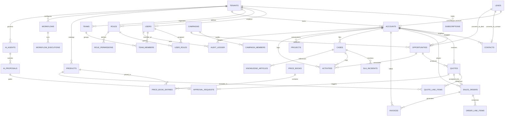

# SYVORIS Ai™ — Database Architecture & Entity Relationship Design
**Enterprise Relational Schema Design, Indexing Strategy, and Mermaid ERD**  
*Document Version: 1.0.0 (Phase 0 Discovery Baseline)*  
*Status: Approved Blueprint*

---

## 1. Data Modeling Principles & Global Conventions

1. **Primary Keys:** Every table utilizes a UUID primary key (preferably timestamp-ordered `UUIDv7` or `UUIDv4`), named `id`.
2. **Tenant Ownership:** Every tenant-partitioned table has a non-nullable `tenant_id UUID REFERENCES tenants(id) ON DELETE CASCADE`.
3. **Audit Columns:** Every table includes:
   - `created_at TIMESTAMPTZ NOT NULL DEFAULT clock_timestamp()`
   - `updated_at TIMESTAMPTZ NOT NULL DEFAULT clock_timestamp()`
   - `created_by UUID REFERENCES users(id)`
   - `updated_by UUID REFERENCES users(id)`
4. **Soft Deletion:** Every business entity implements soft deletion via `deleted_at TIMESTAMPTZ NULL`. Active queries filter `WHERE deleted_at IS NULL` via default ORM scopes and RLS policies.
5. **Custom Fields & Extensibility:** Every business entity includes a `custom_fields JSONB NOT NULL DEFAULT '{}'::jsonb` column, indexed via GIN (`CREATE INDEX ... USING gin(custom_fields)`), validated against tenant field definitions.
6. **Sequence Generation:** Human-readable record references (e.g., `LEAD-2026-00042`) are generated via PostgreSQL transactional sequences scoped per tenant and entity.

---

## 2. Comprehensive Mermaid Entity-Relationship Diagram (ERD)



---

## 3. Relational Entity Specifications by Domain

### 3.1 Tenancy & Identity Tier

#### `tenants` (Platform Partition Master)
```sql
CREATE TABLE tenants (
    id UUID PRIMARY KEY DEFAULT gen_random_uuid(),
    slug VARCHAR(64) NOT NULL UNIQUE,
    name VARCHAR(255) NOT NULL,
    plan_tier VARCHAR(32) NOT NULL DEFAULT 'Starter', -- Starter, Professional, Enterprise, Ultimate
    status VARCHAR(32) NOT NULL DEFAULT 'Active',     -- Provisioning, Active, Suspended, Churned
    custom_domain VARCHAR(255) UNIQUE,
    settings JSONB NOT NULL DEFAULT '{}'::jsonb,
    created_at TIMESTAMPTZ NOT NULL DEFAULT clock_timestamp(),
    updated_at TIMESTAMPTZ NOT NULL DEFAULT clock_timestamp(),
    deleted_at TIMESTAMPTZ NULL
);
CREATE INDEX idx_tenants_slug ON tenants(slug);
CREATE INDEX idx_tenants_custom_domain ON tenants(custom_domain) WHERE custom_domain IS NOT NULL;
```

#### `users` (Tenant User Directory)
```sql
CREATE TABLE users (
    id UUID PRIMARY KEY DEFAULT gen_random_uuid(),
    tenant_id UUID NOT NULL REFERENCES tenants(id) ON DELETE CASCADE,
    email VARCHAR(255) NOT NULL,
    password_hash VARCHAR(255) NOT NULL,
    first_name VARCHAR(100) NOT NULL,
    last_name VARCHAR(100) NOT NULL,
    job_title VARCHAR(100),
    phone VARCHAR(50),
    status VARCHAR(32) NOT NULL DEFAULT 'Active', -- Active, Invited, Suspended, Deactivated
    mfa_enabled BOOLEAN NOT NULL DEFAULT false,
    mfa_secret VARCHAR(128) NULL,
    avatar_url TEXT NULL,
    preferences JSONB NOT NULL DEFAULT '{}'::jsonb,
    last_login_at TIMESTAMPTZ NULL,
    created_at TIMESTAMPTZ NOT NULL DEFAULT clock_timestamp(),
    updated_at TIMESTAMPTZ NOT NULL DEFAULT clock_timestamp(),
    deleted_at TIMESTAMPTZ NULL,
    CONSTRAINT uq_users_tenant_email UNIQUE (tenant_id, email)
);
CREATE INDEX idx_users_tenant_status ON users(tenant_id, status);
```

#### `roles`, `permissions`, `user_roles` (RBAC System)
```sql
CREATE TABLE roles (
    id UUID PRIMARY KEY DEFAULT gen_random_uuid(),
    tenant_id UUID NOT NULL REFERENCES tenants(id) ON DELETE CASCADE,
    name VARCHAR(100) NOT NULL,
    description TEXT,
    is_system_role BOOLEAN NOT NULL DEFAULT false,
    created_at TIMESTAMPTZ NOT NULL DEFAULT clock_timestamp(),
    updated_at TIMESTAMPTZ NOT NULL DEFAULT clock_timestamp(),
    CONSTRAINT uq_roles_tenant_name UNIQUE (tenant_id, name)
);

CREATE TABLE permissions (
    id UUID PRIMARY KEY DEFAULT gen_random_uuid(),
    code VARCHAR(100) NOT NULL UNIQUE, -- e.g. deals:read, deals:create, quotes:approve
    module VARCHAR(50) NOT NULL,
    description TEXT NOT NULL
);

CREATE TABLE role_permissions (
    role_id UUID NOT NULL REFERENCES roles(id) ON DELETE CASCADE,
    permission_id UUID NOT NULL REFERENCES permissions(id) ON DELETE CASCADE,
    PRIMARY KEY (role_id, permission_id)
);

CREATE TABLE user_roles (
    user_id UUID NOT NULL REFERENCES users(id) ON DELETE CASCADE,
    role_id UUID NOT NULL REFERENCES roles(id) ON DELETE CASCADE,
    assigned_by UUID REFERENCES users(id),
    assigned_at TIMESTAMPTZ NOT NULL DEFAULT clock_timestamp(),
    PRIMARY KEY (user_id, role_id)
);
```

---

### 3.2 Core CRM & Relationship Tier

#### `accounts` (Organizations Master)
```sql
CREATE TABLE accounts (
    id UUID PRIMARY KEY DEFAULT gen_random_uuid(),
    tenant_id UUID NOT NULL REFERENCES tenants(id) ON DELETE CASCADE,
    ref VARCHAR(32) NOT NULL,
    name VARCHAR(255) NOT NULL,
    parent_id UUID REFERENCES accounts(id) ON DELETE SET NULL,
    industry VARCHAR(100),
    segment VARCHAR(50), -- Enterprise, Mid-Market, SMB, Public Sector
    website VARCHAR(255),
    phone VARCHAR(50),
    territory VARCHAR(100),
    credit_limit NUMERIC(15, 2) NOT NULL DEFAULT 0.00,
    consent_status VARCHAR(50) NOT NULL DEFAULT 'Pending',
    owner_id UUID NOT NULL REFERENCES users(id),
    billing_address JSONB NOT NULL DEFAULT '{}'::jsonb,
    shipping_address JSONB NOT NULL DEFAULT '{}'::jsonb,
    custom_fields JSONB NOT NULL DEFAULT '{}'::jsonb,
    created_at TIMESTAMPTZ NOT NULL DEFAULT clock_timestamp(),
    updated_at TIMESTAMPTZ NOT NULL DEFAULT clock_timestamp(),
    created_by UUID REFERENCES users(id),
    updated_by UUID REFERENCES users(id),
    deleted_at TIMESTAMPTZ NULL,
    CONSTRAINT uq_accounts_tenant_ref UNIQUE (tenant_id, ref)
);
CREATE INDEX idx_accounts_tenant_owner ON accounts(tenant_id, owner_id) WHERE deleted_at IS NULL;
CREATE INDEX idx_accounts_tenant_name_trgm ON accounts USING gin(name gin_trgm_ops);
CREATE INDEX idx_accounts_custom_fields ON accounts USING gin(custom_fields);
```

#### `contacts` (People Master)
```sql
CREATE TABLE contacts (
    id UUID PRIMARY KEY DEFAULT gen_random_uuid(),
    tenant_id UUID NOT NULL REFERENCES tenants(id) ON DELETE CASCADE,
    ref VARCHAR(32) NOT NULL,
    account_id UUID REFERENCES accounts(id) ON DELETE SET NULL,
    first_name VARCHAR(100) NOT NULL,
    last_name VARCHAR(100) NOT NULL,
    email VARCHAR(255) NOT NULL,
    phone VARCHAR(50),
    job_title VARCHAR(100),
    department VARCHAR(100),
    is_decision_maker BOOLEAN NOT NULL DEFAULT false,
    consent_status VARCHAR(50) NOT NULL DEFAULT 'Pending',
    owner_id UUID NOT NULL REFERENCES users(id),
    custom_fields JSONB NOT NULL DEFAULT '{}'::jsonb,
    created_at TIMESTAMPTZ NOT NULL DEFAULT clock_timestamp(),
    updated_at TIMESTAMPTZ NOT NULL DEFAULT clock_timestamp(),
    created_by UUID REFERENCES users(id),
    updated_by UUID REFERENCES users(id),
    deleted_at TIMESTAMPTZ NULL,
    CONSTRAINT uq_contacts_tenant_ref UNIQUE (tenant_id, ref),
    CONSTRAINT uq_contacts_tenant_email UNIQUE (tenant_id, email)
);
CREATE INDEX idx_contacts_tenant_account ON contacts(tenant_id, account_id) WHERE deleted_at IS NULL;
CREATE INDEX idx_contacts_tenant_email ON contacts(tenant_id, email);
```

#### `leads` (Prospect Intake & Qualification)
```sql
CREATE TABLE leads (
    id UUID PRIMARY KEY DEFAULT gen_random_uuid(),
    tenant_id UUID NOT NULL REFERENCES tenants(id) ON DELETE CASCADE,
    ref VARCHAR(32) NOT NULL,
    first_name VARCHAR(100) NOT NULL,
    last_name VARCHAR(100) NOT NULL,
    company_name VARCHAR(255) NOT NULL,
    job_title VARCHAR(100),
    email VARCHAR(255) NOT NULL,
    phone VARCHAR(50),
    source VARCHAR(100), -- Website, Partner, Trade Event, Outbound, Referral
    industry VARCHAR(100),
    territory VARCHAR(100),
    status VARCHAR(50) NOT NULL DEFAULT 'New', -- New, Contacted, Qualified, Unqualified, Converted
    score INTEGER NOT NULL DEFAULT 0,
    priority VARCHAR(32) NOT NULL DEFAULT 'Normal',
    owner_id UUID REFERENCES users(id),
    consent_status VARCHAR(50) NOT NULL DEFAULT 'Pending',
    converted_account_id UUID REFERENCES accounts(id),
    converted_contact_id UUID REFERENCES contacts(id),
    converted_opportunity_id UUID REFERENCES opportunities(id),
    converted_at TIMESTAMPTZ NULL,
    custom_fields JSONB NOT NULL DEFAULT '{}'::jsonb,
    created_at TIMESTAMPTZ NOT NULL DEFAULT clock_timestamp(),
    updated_at TIMESTAMPTZ NOT NULL DEFAULT clock_timestamp(),
    created_by UUID REFERENCES users(id),
    updated_by UUID REFERENCES users(id),
    deleted_at TIMESTAMPTZ NULL,
    CONSTRAINT uq_leads_tenant_ref UNIQUE (tenant_id, ref)
);
CREATE INDEX idx_leads_tenant_status ON leads(tenant_id, status) WHERE deleted_at IS NULL;
CREATE INDEX idx_leads_tenant_score ON leads(tenant_id, score DESC);
```

---

### 3.3 Sales, CPQ & Revenue Tier

#### `opportunities` (Deals & Pipeline Execution)
```sql
CREATE TABLE opportunities (
    id UUID PRIMARY KEY DEFAULT gen_random_uuid(),
    tenant_id UUID NOT NULL REFERENCES tenants(id) ON DELETE CASCADE,
    ref VARCHAR(32) NOT NULL,
    name VARCHAR(255) NOT NULL,
    account_id UUID NOT NULL REFERENCES accounts(id) ON DELETE RESTRICT,
    contact_id UUID REFERENCES contacts(id) ON DELETE SET NULL,
    pipeline_id UUID NOT NULL,
    stage VARCHAR(100) NOT NULL, -- New, Qualification, Discovery, Proposal, Negotiation, Closed Won, Closed Lost
    amount NUMERIC(15, 2) NOT NULL DEFAULT 0.00,
    currency VARCHAR(3) NOT NULL DEFAULT 'USD',
    probability INTEGER NOT NULL DEFAULT 10,
    expected_close_date DATE NOT NULL,
    forecast_category VARCHAR(50) NOT NULL DEFAULT 'Pipeline', -- Pipeline, Best Case, Commit, Closed
    risk_level VARCHAR(32) NOT NULL DEFAULT 'Low',             -- Low, Medium, High
    lead_source VARCHAR(100),
    competitor_id UUID NULL,
    loss_reason TEXT NULL,
    owner_id UUID NOT NULL REFERENCES users(id),
    custom_fields JSONB NOT NULL DEFAULT '{}'::jsonb,
    created_at TIMESTAMPTZ NOT NULL DEFAULT clock_timestamp(),
    updated_at TIMESTAMPTZ NOT NULL DEFAULT clock_timestamp(),
    created_by UUID REFERENCES users(id),
    updated_by UUID REFERENCES users(id),
    deleted_at TIMESTAMPTZ NULL,
    CONSTRAINT uq_opps_tenant_ref UNIQUE (tenant_id, ref)
);
CREATE INDEX idx_opps_tenant_stage ON opportunities(tenant_id, stage) WHERE deleted_at IS NULL;
CREATE INDEX idx_opps_tenant_close ON opportunities(tenant_id, expected_close_date);
```

#### `quotes` & `quote_line_items` (CPQ Engine)
```sql
CREATE TABLE quotes (
    id UUID PRIMARY KEY DEFAULT gen_random_uuid(),
    tenant_id UUID NOT NULL REFERENCES tenants(id) ON DELETE CASCADE,
    ref VARCHAR(32) NOT NULL,
    version INTEGER NOT NULL DEFAULT 1,
    parent_quote_id UUID REFERENCES quotes(id),
    name VARCHAR(255) NOT NULL,
    opportunity_id UUID REFERENCES opportunities(id) ON DELETE SET NULL,
    account_id UUID NOT NULL REFERENCES accounts(id) ON DELETE RESTRICT,
    contact_id UUID REFERENCES contacts(id) ON DELETE SET NULL,
    price_book_id UUID NULL,
    status VARCHAR(50) NOT NULL DEFAULT 'Draft', -- Draft, Pending Approval, Approved, Sent, Accepted, Rejected
    valid_until DATE NOT NULL,
    currency VARCHAR(3) NOT NULL DEFAULT 'USD',
    header_discount_pct NUMERIC(5, 2) NOT NULL DEFAULT 0.00,
    subtotal NUMERIC(15, 2) NOT NULL DEFAULT 0.00,
    total_discount NUMERIC(15, 2) NOT NULL DEFAULT 0.00,
    total_tax NUMERIC(15, 2) NOT NULL DEFAULT 0.00,
    grand_total NUMERIC(15, 2) NOT NULL DEFAULT 0.00,
    payment_terms VARCHAR(50) NOT NULL DEFAULT 'Net 30',
    notes TEXT,
    owner_id UUID NOT NULL REFERENCES users(id),
    custom_fields JSONB NOT NULL DEFAULT '{}'::jsonb,
    created_at TIMESTAMPTZ NOT NULL DEFAULT clock_timestamp(),
    updated_at TIMESTAMPTZ NOT NULL DEFAULT clock_timestamp(),
    created_by UUID REFERENCES users(id),
    updated_by UUID REFERENCES users(id),
    deleted_at TIMESTAMPTZ NULL,
    CONSTRAINT uq_quotes_tenant_ref_version UNIQUE (tenant_id, ref, version)
);

CREATE TABLE quote_line_items (
    id UUID PRIMARY KEY DEFAULT gen_random_uuid(),
    tenant_id UUID NOT NULL REFERENCES tenants(id) ON DELETE CASCADE,
    quote_id UUID NOT NULL REFERENCES quotes(id) ON DELETE CASCADE,
    product_id UUID REFERENCES products(id) ON DELETE RESTRICT,
    item_name VARCHAR(255) NOT NULL,
    sku VARCHAR(100),
    quantity NUMERIC(12, 4) NOT NULL DEFAULT 1.00,
    unit_price NUMERIC(15, 2) NOT NULL,
    discount_pct NUMERIC(5, 2) NOT NULL DEFAULT 0.00,
    tax_rate NUMERIC(5, 2) NOT NULL DEFAULT 0.00,
    line_total NUMERIC(15, 2) NOT NULL,
    sort_order INTEGER NOT NULL DEFAULT 0,
    created_at TIMESTAMPTZ NOT NULL DEFAULT clock_timestamp()
);
CREATE INDEX idx_quote_lines_quote ON quote_line_items(quote_id);
```

#### `sales_orders` & `invoices` (Order-to-Cash Execution)
```sql
CREATE TABLE sales_orders (
    id UUID PRIMARY KEY DEFAULT gen_random_uuid(),
    tenant_id UUID NOT NULL REFERENCES tenants(id) ON DELETE CASCADE,
    ref VARCHAR(32) NOT NULL,
    quote_id UUID REFERENCES quotes(id),
    account_id UUID NOT NULL REFERENCES accounts(id),
    status VARCHAR(50) NOT NULL DEFAULT 'Confirmed', -- Confirmed, Allocated, Packed, Shipped, Delivered, Cancelled
    fulfilment_stage VARCHAR(50) NOT NULL DEFAULT 'Placed',
    total_amount NUMERIC(15, 2) NOT NULL,
    currency VARCHAR(3) NOT NULL DEFAULT 'USD',
    warehouse_location VARCHAR(100),
    requested_delivery_date DATE,
    carrier VARCHAR(100),
    tracking_number VARCHAR(100),
    owner_id UUID NOT NULL REFERENCES users(id),
    created_at TIMESTAMPTZ NOT NULL DEFAULT clock_timestamp(),
    updated_at TIMESTAMPTZ NOT NULL DEFAULT clock_timestamp(),
    deleted_at TIMESTAMPTZ NULL,
    CONSTRAINT uq_orders_tenant_ref UNIQUE (tenant_id, ref)
);

CREATE TABLE invoices (
    id UUID PRIMARY KEY DEFAULT gen_random_uuid(),
    tenant_id UUID NOT NULL REFERENCES tenants(id) ON DELETE CASCADE,
    ref VARCHAR(32) NOT NULL,
    sales_order_id UUID REFERENCES sales_orders(id),
    account_id UUID NOT NULL REFERENCES accounts(id),
    status VARCHAR(50) NOT NULL DEFAULT 'Issued', -- Draft, Issued, Partially Paid, Paid, Overdue, Void
    issue_date DATE NOT NULL,
    due_date DATE NOT NULL,
    total_amount NUMERIC(15, 2) NOT NULL,
    paid_amount NUMERIC(15, 2) NOT NULL DEFAULT 0.00,
    currency VARCHAR(3) NOT NULL DEFAULT 'USD',
    created_at TIMESTAMPTZ NOT NULL DEFAULT clock_timestamp(),
    updated_at TIMESTAMPTZ NOT NULL DEFAULT clock_timestamp(),
    deleted_at TIMESTAMPTZ NULL,
    CONSTRAINT uq_invoices_tenant_ref UNIQUE (tenant_id, ref)
);
```

---

### 3.4 Customer Support & Service Desk Tier

#### `cases` (Support Tickets Master)
```sql
CREATE TABLE cases (
    id UUID PRIMARY KEY DEFAULT gen_random_uuid(),
    tenant_id UUID NOT NULL REFERENCES tenants(id) ON DELETE CASCADE,
    ref VARCHAR(32) NOT NULL,
    subject VARCHAR(255) NOT NULL,
    account_id UUID REFERENCES accounts(id),
    contact_id UUID REFERENCES contacts(id),
    status VARCHAR(50) NOT NULL DEFAULT 'New', -- New, Assigned, In Progress, Awaiting Customer, Resolved, Closed
    priority VARCHAR(32) NOT NULL DEFAULT 'Normal', -- Low, Normal, High, Critical
    category VARCHAR(100) NOT NULL,
    channel VARCHAR(50) NOT NULL DEFAULT 'Email',  -- Email, Portal, Chat, Phone, Webform
    sentiment VARCHAR(32) DEFAULT 'Neutral',
    assigned_user_id UUID REFERENCES users(id),
    assigned_queue_id UUID NULL,
    sla_policy_id UUID NULL,
    sla_response_deadline TIMESTAMPTZ,
    sla_resolution_deadline TIMESTAMPTZ,
    sla_breached BOOLEAN NOT NULL DEFAULT false,
    resolution_summary TEXT NULL,
    resolved_at TIMESTAMPTZ NULL,
    csat_score INTEGER NULL,
    created_at TIMESTAMPTZ NOT NULL DEFAULT clock_timestamp(),
    updated_at TIMESTAMPTZ NOT NULL DEFAULT clock_timestamp(),
    deleted_at TIMESTAMPTZ NULL,
    CONSTRAINT uq_cases_tenant_ref UNIQUE (tenant_id, ref)
);
CREATE INDEX idx_cases_tenant_status ON cases(tenant_id, status) WHERE deleted_at IS NULL;
CREATE INDEX idx_cases_tenant_sla ON cases(tenant_id, sla_resolution_deadline) WHERE status NOT IN ('Resolved', 'Closed');
```

---

### 3.5 Workflow, AI & Audit Governance Tier

#### `approval_requests` (Governed Approvals Engine)
```sql
CREATE TABLE approval_requests (
    id UUID PRIMARY KEY DEFAULT gen_random_uuid(),
    tenant_id UUID NOT NULL REFERENCES tenants(id) ON DELETE CASCADE,
    ref VARCHAR(32) NOT NULL,
    entity_type VARCHAR(50) NOT NULL, -- quote, decision, discount, deal
    entity_id UUID NOT NULL,
    requested_by UUID NOT NULL REFERENCES users(id),
    assigned_to_role VARCHAR(100),
    assigned_to_user UUID REFERENCES users(id),
    action_type VARCHAR(100) NOT NULL,
    details TEXT NOT NULL,
    status VARCHAR(50) NOT NULL DEFAULT 'Pending Approval', -- Pending Approval, Approved, Rejected, Cancelled
    decision_reason TEXT,
    decided_by UUID REFERENCES users(id),
    decided_at TIMESTAMPTZ NULL,
    created_at TIMESTAMPTZ NOT NULL DEFAULT clock_timestamp(),
    CONSTRAINT uq_approvals_tenant_ref UNIQUE (tenant_id, ref)
);
CREATE INDEX idx_approvals_tenant_status ON approval_requests(tenant_id, status);
```

#### `ai_agents` & `ai_proposals` (Specialist Workforce & Governance)
```sql
CREATE TABLE ai_agents (
    id UUID PRIMARY KEY DEFAULT gen_random_uuid(),
    tenant_id UUID NOT NULL REFERENCES tenants(id) ON DELETE CASCADE,
    ref VARCHAR(32) NOT NULL,
    name VARCHAR(100) NOT NULL,
    persona VARCHAR(50) NOT NULL, -- SDR, Deal, Quote, Service, Save-Play, etc.
    module VARCHAR(50) NOT NULL,
    autonomy_level VARCHAR(50) NOT NULL DEFAULT 'Suggest Only', -- Suggest Only, Act with Approval, Act Autonomously
    status VARCHAR(32) NOT NULL DEFAULT 'Active',               -- Active, Paused, Disabled
    system_prompt TEXT,
    tool_permissions JSONB NOT NULL DEFAULT '[]'::jsonb,
    owner_id UUID NOT NULL REFERENCES users(id),
    created_at TIMESTAMPTZ NOT NULL DEFAULT clock_timestamp(),
    updated_at TIMESTAMPTZ NOT NULL DEFAULT clock_timestamp()
);

CREATE TABLE ai_proposals (
    id UUID PRIMARY KEY DEFAULT gen_random_uuid(),
    tenant_id UUID NOT NULL REFERENCES tenants(id) ON DELETE CASCADE,
    ref VARCHAR(32) NOT NULL,
    agent_id UUID NOT NULL REFERENCES ai_agents(id) ON DELETE CASCADE,
    action VARCHAR(255) NOT NULL,
    reasoning TEXT NOT NULL,
    evidence TEXT,
    confidence NUMERIC(3, 2),
    policy_check VARCHAR(100) NOT NULL,
    status VARCHAR(50) NOT NULL DEFAULT 'Pending Approval',
    payload JSONB NOT NULL DEFAULT '{}'::jsonb,
    created_at TIMESTAMPTZ NOT NULL DEFAULT clock_timestamp()
);
```

#### `audit_ledger` (Immutable Audit Trail)
```sql
CREATE TABLE audit_ledger (
    id BIGSERIAL PRIMARY KEY,
    tenant_id UUID NOT NULL REFERENCES tenants(id) ON DELETE CASCADE,
    ref VARCHAR(32) NOT NULL,
    actor_id UUID NULL REFERENCES users(id),
    actor_name VARCHAR(255) NOT NULL DEFAULT 'System',
    action VARCHAR(100) NOT NULL,
    entity_type VARCHAR(50) NOT NULL,
    entity_id UUID NOT NULL,
    record_ref VARCHAR(50),
    ip_address INET,
    user_agent TEXT,
    diff_payload JSONB NOT NULL DEFAULT '{}'::jsonb, -- before/after state diff
    created_at TIMESTAMPTZ NOT NULL DEFAULT clock_timestamp()
);
CREATE INDEX idx_audit_tenant_entity ON audit_ledger(tenant_id, entity_type, entity_id);
CREATE INDEX idx_audit_tenant_created ON audit_ledger(tenant_id, created_at DESC);
-- Prohibit updates or deletes on audit ledger
CREATE RULE no_update_audit AS ON UPDATE TO audit_ledger DO INSTEAD NOTHING;
CREATE RULE no_delete_audit AS ON DELETE TO audit_ledger DO INSTEAD NOTHING;
```
