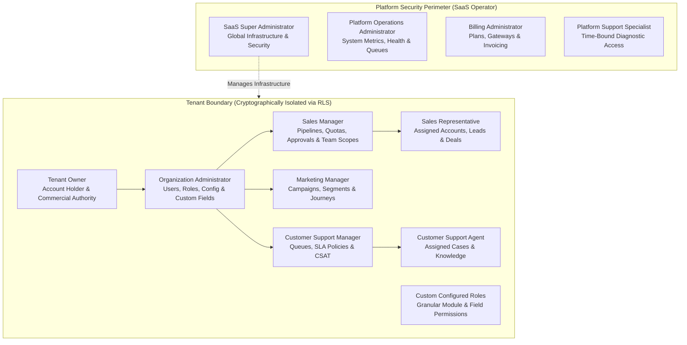

# SYVORIS Ai™ — Security, RBAC & Threat Model Specification
**Multi-Tenant Authorization, Field-Level Security, and STRIDE Security Architecture**  
*Document Version: 1.0.0 (Phase 0 Discovery Baseline)*  
*Status: Approved Blueprint*

---

## 1. Multi-Tier Administrative & Authorization Structure

SYVORIS Ai maintains a strict architectural boundary between **Platform-Level Administration** (SaaS infrastructure operator) and **Tenant-Level Administration** (customer organization). Under no circumstances can a tenant administrator access platform infrastructure or view other tenant partitions.

---

## 2. Granular Access Control Model: RBAC, Record Scopes & FLS

### 2.1 Four-Dimensional Permission Matrix
Access to any data entity in SYVORIS Ai is evaluated along four distinct dimensions:
1. **Module-Level Access:** Can the user access the module at all? (e.g., `deals:view`, `deals:create`, `deals:delete`, `deals:export`).
2. **Record-Level Scope (Sharing Rules):** Which records within the module can the user access?
   - *Private:* User can only access records they own.
   - *Team / Subordinate:* User can access their records plus records owned by direct and indirect reports in the organizational hierarchy.
   - *Territory / Queue:* User can access records tagged with their assigned territory or queue.
   - *Public Read-Only:* All users in the tenant can view; only owner can edit.
   - *Public Read/Write:* All users in the tenant can view and edit.
3. **Field-Level Security (FLS):** Can the user view or edit specific sensitive fields?
   - *Read-Write:* Full visibility and update capability.
   - *Read-Only:* Visible in UI and API responses; mutations rejected with `HTTP 403`.
   - *Hidden:* Omitted from API serialization payloads; completely invisible in UI.
   - *Sensitive Examples:* Customer Credit Limit, Margin %, Tax Identification Number, Bank Details.
4. **Operation Permission:** Can the user perform governed high-impact operations?
   - Examples: `quotes:approve_discount`, `leads:bulk_export`, `admin:manage_workflows`, `ai:approve_action`.

---

## 3. Comprehensive STRIDE Threat Modeling

We conduct an exhaustive STRIDE security assessment across the SYVORIS Ai SaaS surface:

### 3.1 Spoofing (Identity & Tenancy Impersonation)
- **Threat Vector:** An attacker crafts a counterfeit JWT or submits requests with a forged `tenant_id` header or URL parameter to access another company's records.
- **Impact:** Critical cross-tenant corporate data breach.
- **Architectural Countermeasures:**
  1. Asymmetric cryptographic signing (RS256 / Ed25519) for all JWT tokens.
  2. Public keys rotated regularly; private keys stored exclusively in a secure Key Management Service (AWS KMS / HashiCorp Vault).
  3. `tenant_id` is extracted strictly from the cryptographically validated token payload and correlated against the verified hostname.
  4. Client-supplied `tenant_id` parameters in query strings or request bodies are strictly rejected or ignored.

### 3.2 Tampering (Data Manipulation & Parameter Tampering)
- **Threat Vector:** A malicious sales representative intercepts API requests to modify line-item prices on an approved quote, bypass discount limits, or inject SQL into custom fields.
- **Impact:** Commercial revenue loss, contract disputes, database compromise.
- **Architectural Countermeasures:**
  1. All commercial totals (subtotals, discounts, taxes, grand totals) are recomputed authoritatively on the backend during save/submit.
  2. Strict Pydantic v2 schemas reject unexpected attributes (`extra="forbid"`).
  3. All database queries execute via parameterized SQLAlchemy Core statements; zero raw string SQL interpolation.
  4. Outbound webhooks sign JSON payloads with HMAC SHA-256 using tenant-specific shared secrets (`X-Syvoris-Signature`).

### 3.3 Repudiation (Denial of Action)
- **Threat Vector:** A disgruntled employee deletes high-value enterprise accounts, exports proprietary prospect lists, or approves an unauthorized AI agent proposal, and denies performing the action.
- **Impact:** Data loss, insider threats, regulatory non-compliance.
- **Architectural Countermeasures:**
  1. Append-only `audit_ledger` records every state mutation, user login, export, and permission alteration.
  2. Database rules (`no_update_audit`, `no_delete_audit`) enforce write-once immutability at the PostgreSQL engine level.
  3. Every audit log captures the user ID, tenant ID, timestamp, client IP, user agent, and a structured before/after JSON diff of modified attributes.

### 3.4 Information Disclosure (Data Leakage & Cross-Tenant Visibility)
- **Threat Vector:** A multi-tenant query omits tenant filtering; an error message leaks database table names and stack traces; sensitive customer fields are returned in generic API responses.
- **Impact:** Competitive intelligence leakage, GDPR/CCPA compliance fines.
- **Architectural Countermeasures:**
  1. PostgreSQL Row-Level Security (`FORCE ROW LEVEL SECURITY`) guarantees query isolation even on unrestricted developer queries.
  2. Field-Level Security (FLS) serializers sanitize sensitive fields from API responses before network transmission.
  3. API production error handlers serialize generic RFC 7807 problem details, suppressing stack traces and internal identifiers.
  4. All communication over the wire requires TLS 1.3 with forward secrecy; all databases, caches, and S3 buckets employ AES-256 encryption at rest.

### 3.5 Denial of Service (Resource Starvation & Noisy Neighbors)
- **Threat Vector:** A single tenant scripts aggressive bulk API calls or triggers computationally expensive multi-million-row reports, degrading responsiveness for other subscribers.
- **Impact:** SLA violation, platform downtime, degraded user experience.
- **Architectural Countermeasures:**
  1. Distributed token-bucket rate limiting (Redis-backed) partitioned per tenant and per IP address.
  2. Heavy analytical queries and report generations are delegated to Celery background workers with strict query execution timeouts (`statement_timeout = 10000ms`).
  3. Cursor-based pagination enforces hard upper limits (`limit <= 100`) on collection endpoints.

### 3.6 Elevation of Privilege (Unauthorized Administrative Escalation)
- **Threat Vector:** A sales representative modifies client-side JavaScript or submits a crafted API request to grant themselves the `System Administrator` role or approve their own quote.
- **Impact:** Complete tenant environment takeover.
- **Architectural Countermeasures:**
  1. Zero trust in frontend client state: role switches in the UI trigger zero backend privilege elevation.
  2. Every API endpoint enforces atomic dependency checks: `Depends(require_permission("quotes:approve"))`.
  3. Separation of duties: a quote creator cannot approve their own quote even if they hold the managerial role (`requested_by != decided_by`).

---

## 4. Cryptographic Standards & Key Management

| Domain | Standard / Algorithm | Operational Detail |
|---|---|---|
| **User Passwords** | Argon2id (`m=65536, t=3, p=4`) | Industry-leading resistance to GPU/ASIC password cracking. |
| **API Session Tokens (JWT)**| RS256 / EdDSA (Asymmetric) | Short-lived access tokens (15 mins) + rotating refresh tokens (7 days). |
| **Webhook Signatures** | HMAC SHA-256 | Delivered via `X-Syvoris-Signature: t={timestamp},v1={hash}` header. |
| **Data in Transit** | TLS 1.3 (Strict HSTS) | Grade A+ SSL Labs configuration; TLS 1.0/1.1 disabled. |
| **Data at Rest** | AES-256-GCM | Encrypted PostgreSQL tablespaces, Redis AOF files, and S3 objects. |
| **API Key Storage** | SHA-256 Hash with Salt | Raw keys shown only once (`syv_live_...`); stored exclusively as hashes. |
