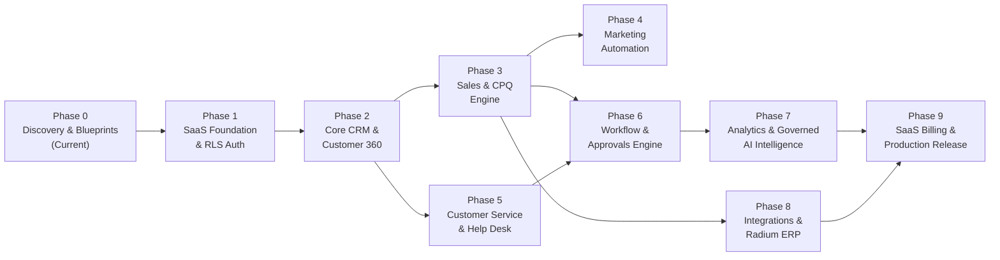

# SYVORIS Ai™ — Phased Development & Implementation Roadmap
**Ten-Phase Engineering Plan, Dependency Gates, and Verification Milestones**  
*Document Version: 1.0.0 (Phase 0 Discovery Baseline)*  
*Status: Approved Blueprint*

---

## 1. Phased Development Methodology

Development follows a strict **Phased Delivery Runtime**:
- Every phase has defined technical deliverables, explicit prerequisites, automated test suites, and strict acceptance gates.
- No phase begins until the preceding phase's acceptance criteria are verified with executable proof.
- Existing frontend components and routes are preserved and progressively wired to backend APIs.
- Code quality checks (`npm run check:project`, `npm run typecheck`, `npm run build`, backend unit tests) must pass on every milestone.

---

## 2. Phase-by-Phase Implementation Specifications

### Phase 0: Product Discovery & Architectural Blueprints (CURRENT MILESTONE)
- **Scope:** Full codebase audit, competitor capability research, multi-tenant database modeling, API specification, threat modeling, and implementation roadmap.
- **Deliverables:**
  - Complete `docs/blueprint/` suite (11 architectural deliverables).
  - High-level system architecture and database Mermaid ERD diagrams.
  - Baseline verification of existing React/TypeScript build checks.
- **Dependencies:** None.
- **Exit Criteria:** Complete presentation and stakeholder approval of the Phase 0 Discovery Report. Zero modification of existing frontend source code.

---

### Phase 1: SaaS Foundation, Multi-Tenancy & Identity
- **Scope:** Backend setup (FastAPI), PostgreSQL 16 database migrations, tenant provisioning service, JWT authentication with refresh token rotation, Argon2id password hashing, and kernel-level PostgreSQL Row-Level Security (RLS).
- **Deliverables:**
  - FastAPI application structure (`app/core`, `app/api/v1`, `app/models`, `app/services`, `app/db`).
  - Alembic database migration scripts for `tenants`, `users`, `roles`, `permissions`, `audit_ledger`.
  - Kernel RLS policies on all initial tables enforcing `tenant_id`.
  - Authentication endpoints (`/api/v1/auth/register`, `/login`, `/refresh`, `/me`).
  - Automated integration tests verifying 100% tenant isolation across database queries and API endpoints.
- **Dependencies:** Phase 0 approval.
- **Verification Gate:** Passing automated tests: `test_tenant_isolation_rls`, `test_jwt_auth_rotation`, `test_rate_limiting`.

---

### Phase 2: Core CRM, Customer 360 & Lead Conversion
- **Scope:** Relational implementation of Accounts, Contacts, Leads, Relationships, and Activities. Atomic Lead Conversion Engine. Wiring `Customer360View.tsx` and `LeadConversionModal.tsx` to real backend APIs.
- **Deliverables:**
  - Database migrations for `accounts`, `contacts`, `leads`, `activities`, `account_relationships`.
  - REST endpoints (`/api/v1/accounts`, `/api/v1/contacts`, `/api/v1/leads`).
  - Atomic transactional conversion endpoint `/api/v1/leads/{id}/convert`.
  - Dynamic Trigram (`pg_trgm`) duplicate detection and side-by-side record merge API.
  - Frontend integration: replace `localStorage` calls in `Customer360View` and `LeadConversionModal` with real API client hooks.
- **Dependencies:** Phase 1 (Tenancy & Auth).
- **Verification Gate:** Lead conversion integration test confirming atomic creation of Account, Contact, and Opportunity in a single transaction with zero orphan records.

---

### Phase 3: Sales Force Automation, Pipelines & CPQ Engine
- **Scope:** Multi-pipeline Kanban opportunity management, stage-gate validation, sales quotas, price books, multi-line CPQ quote builder, and sales order/invoice conversion.
- **Deliverables:**
  - Migrations for `opportunities`, `price_books`, `products`, `quotes`, `quote_line_items`, `sales_orders`, `invoices`.
  - Server-side CPQ calculation engine (gross, discount, tax, margin, grand total).
  - Versioned quote revisioning (`quote_revisions`).
  - Frontend integration: wire `WorkspacePage` (Kanban), `QuoteDocumentView`, and commercial line editors to backend REST endpoints.
- **Dependencies:** Phase 2 (Core CRM).
- **Verification Gate:** CPQ math test verifying zero floating-point discrepancies; stage gate test enforcing mandatory fields before advancing opportunity stage.

---

### Phase 4: Marketing Automation & Audience Segmentation
- **Scope:** Multi-channel campaign lifecycle, dynamic audience segmentation engine, email template registry, and campaign ROI / revenue attribution modeling.
- **Deliverables:**
  - Migrations for `campaigns`, `segments`, `email_templates`, `campaign_members`.
  - Parameterized AST rule evaluator for dynamic segment filtering.
  - Mandatory consent gating: exclusion of opted-out contacts from campaign member lists.
  - Multi-touch revenue attribution ledger linking closed-won deals to marketing touchpoints.
- **Dependencies:** Phase 2 (Core CRM) & Phase 3 (Opportunities).
- **Verification Gate:** Segment test confirming 100% exclusion of opted-out contacts; attribution test calculating accurate ROI from closed-won opportunities.

---

### Phase 5: Customer Service Desk & SLA Management
- **Scope:** Multi-channel case management, Email-to-Case ingestion, tiered SLA policies linked to business hours calendars, knowledge base full-text search, and customer portal API.
- **Deliverables:**
  - Migrations for `cases`, `sla_policies`, `business_hours`, `knowledge_articles`.
  - Celery Beat SLA countdown monitor running every 60 seconds with breach alert dispatch.
  - PostgreSQL full-text search (`tsvector`) for knowledge articles.
  - Customer self-service portal authentication and ticket submission API.
- **Dependencies:** Phase 2 (Core CRM).
- **Verification Gate:** SLA timer test verifying pause behavior during non-business hours; email-to-case test parsing inbound emails and associating them to existing threads.

---

### Phase 6: Visual Workflow Automation & Approval Engine
- **Scope:** Event-driven domain event fabric (Redis Pub/Sub), asynchronous workflow trigger runner, multi-stage approval engine, and process execution logging.
- **Deliverables:**
  - Migrations for `workflows`, `workflow_executions`, `approval_requests`.
  - Celery task executor running immediate and time-delayed workflow actions.
  - Multi-tier approval routing for commercial quotes and high-risk AI proposals.
  - Wire `ApprovalsView.tsx` and `WorkflowDesignerView.tsx` to real backend endpoints.
- **Dependencies:** Phase 3 (CPQ) & Phase 5 (Cases).
- **Verification Gate:** Approval workflow test confirming records lock in 'Pending Approval' until authorized by designated role; audit trail logs all approvals.

---

### Phase 7: Analytics, Reporting & Governed AI Intelligence
- **Scope:** Custom report builder, revenue forecasting rollups, multi-provider LLM gateway, grounded RAG pipeline via `pgvector`, and runtime for the 14 specialist agent personas.
- **Deliverables:**
  - AI Gateway proxy routing prompts across Claude 3.5 Sonnet, GPT-4o, and Gemini 1.5 Pro.
  - Vector embeddings pipeline (`pgvector`) indexing customer notes and cases for RAG.
  - Agent runtime executing the 14 specialist personas within three-tier governance limits.
  - Connect `AIWorkspace.tsx` (Copilot chat, agent workforce cards, revenue twin) to real backend AI streams.
- **Dependencies:** Phase 3 (Sales), Phase 5 (Service), Phase 6 (Approvals).
- **Verification Gate:** RAG grounding test verifying zero cross-tenant vector retrieval; governance test verifying that 'Act with Approval' agents never write directly to the database.

---

### Phase 8: Integrations, Webhook Fabric & Radium ERP Connector
- **Scope:** Public REST API platform, outbound webhook delivery with HMAC SHA-256 signatures, email/calendar sync daemons, and decoupled Radium ERP integration bridge.
- **Deliverables:**
  - Webhook delivery worker with exponential backoff retries and dead-letter queue.
  - Email (IMAP/Graph) and Calendar (CalDAV/Google) synchronization workers.
  - Radium ERP bridge: master catalog synchronization, inventory stock balance queries, and sales order export.
  - Wire `IntegrationWorkspace.tsx` and `RadiumConnectorView.tsx` to real integration endpoints.
- **Dependencies:** Phase 3 (CPQ) & Phase 6 (Workflows).
- **Verification Gate:** Radium ERP sync test confirming successful bi-directional data exchange with verifiable synchronization logs; webhook retry test verifying exponential backoff.

---

### Phase 9: SaaS Commercialization, Metering & Production Hardening
- **Scope:** Stripe subscription billing, tenant lifecycle automation, usage metering (users, storage, AI tokens), feature entitlements, security audits, and production deployment.
- **Deliverables:**
  - Stripe webhook handler for subscription creation, upgrades, downgrades, and cancellations.
  - Tenant usage metering engine tracking seat counts, storage gigabytes, and LLM token usage.
  - Production Docker containers, Kubernetes/Compose manifests, Nginx reverse proxy configs.
  - Final penetration testing, SOC2 readiness audit, and performance load testing (p95 < 200ms).
- **Dependencies:** Phases 1 through 8.
- **Verification Gate:** End-to-end commercial lifecycle test: signup -> stripe payment -> tenant provisioning -> active CRM usage -> invoice generation.

---

## 3. High-Level Engineering Milestone Schedule

| Milestone | Phase Focus | Key Deliverable | Gating Prerequisite |
|---|---|---|---|
| **M0** | Phase 0: Discovery & Architecture | 11 Blueprint Documents in `docs/blueprint/` | Phase 0 Approval |
| **M1** | Phase 1: SaaS Foundation | FastAPI Backend, PostgreSQL RLS, JWT Auth | M0 Approved |
| **M2** | Phase 2: Core CRM | Accounts, Contacts, Leads, Atomic Conversion | M1 Validated |
| **M3** | Phase 3: Sales & CPQ | Pipelines, Multi-Line CPQ, Quotes, Orders | M2 Validated |
| **M4** | Phase 4 & 5: Marketing & Service | Campaigns, Segments, Cases, SLAs, Portal | M3 Validated |
| **M5** | Phase 6: Workflow & Approvals | Visual Workflows, Event Bus, Approvals | M4 Validated |
| **M6** | Phase 7: AI Intelligence | LLM Gateway, 14 Agents, Governance | M5 Validated |
| **M7** | Phase 8: Integrations & ERP | Webhooks, Communication Sync, Radium ERP | M6 Validated |
| **M8** | Phase 9: Commercial Release | Stripe Billing, Metering, Production Deploy | M7 Validated |
