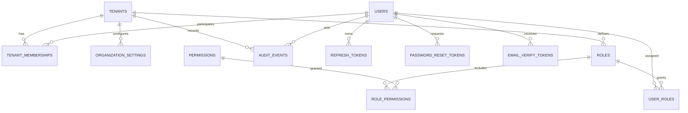

# SYVORIS Ai™ — Phase 1: Multi-Tenant SaaS Foundation Implementation Plan
**Engineering Blueprint, Technical Specifications, and Implementation Roadmap**  
*Document Version: 1.0.0*  
*Status: Awaiting Stakeholder Approval*

---

## 1. Executive Summary & Phase 1 Scope

### 1.1 Objective
Phase 1 transforms the existing SYVORIS Ai React + TypeScript prototype into a genuinely functional, secure, multi-tenant SaaS application. It establishes the enterprise backend service, connects the relational PostgreSQL database, enforces kernel-level tenant isolation, provides production-grade authentication with RBAC, and integrates the existing frontend shell with real backend identity and tenant management.

### 1.2 Strict Scope Boundaries
- **IN SCOPE (Phase 1):**
  1. **Backend Infrastructure:** Modular Python FastAPI (ASGI) application with SQLAlchemy 2.0 (asyncio), Alembic migrations, Pydantic v2 schemas, structured logging, health checks, and OpenAPI 3.1 documentation.
  2. **PostgreSQL Relational Schema:** Core foundational tables (`tenants`, `users`, `tenant_memberships`, `roles`, `permissions`, `role_permissions`, `user_roles`, `refresh_tokens`, `password_reset_tokens`, `email_verification_tokens`, `organization_settings`, `audit_events`).
  3. **Multi-Tenant Isolation:** PostgreSQL Row-Level Security (RLS) policies, FastAPI tenant resolution middleware (`contextvars`), connection pool session recycling, and zero cross-tenant leakage.
  4. **Authentication & Identity:** User registration, tenant owner onboarding, login, logout, refresh token rotation, Argon2id password hashing, password recovery, email verification (with documented dev adapter), and session revocation.
  5. **Role-Based Access Control (RBAC):** Platform-level vs. Tenant-level authorization boundaries, module and action permissions, role assignment, and API-level permission dependencies.
  6. **Tenant Administration:** Organization profile, tenant settings, user invitation, user activation/deactivation, and role management.
  7. **Audit Logging:** Append-only tamper-proof audit ledger capturing all auth, security, administrative, and membership events.
  8. **Frontend Integration:** Wire `Login.tsx`, registration, user profile, `/admin/users`, `/admin/roles`, and `/admin/audit` to real backend APIs while preserving all 132 routes and existing CRM workspaces.
  9. **Automated Testing:** Pytest suite covering auth, tenant isolation (Tenant A vs. Tenant B), RBAC enforcement, and database transactions.

- **EXPLICITLY DEFERRED (Subsequent Phases):**
  - Core CRM transactions (Leads, Contacts, Accounts, Customer 360) -> Phase 2.
  - Sales pipelines, CPQ, quotes, orders, and invoices -> Phase 3.
  - Marketing campaigns, journeys, and segmentation -> Phase 4.
  - Customer service cases, SLAs, and knowledge base -> Phase 5.
  - Visual workflow automation and approvals engine -> Phase 6.
  - AI copilot, agent runtime, and vector search -> Phase 7.
  - External connectors and Radium ERP bridge -> Phase 8.
  - Stripe subscription billing and payment gateways -> Phase 9.

---

## 2. Backend Architecture Specification

### 2.1 Backend Directory Layout
The backend service will be established in a clean `backend/` directory within the workspace, maintaining a strict modular separation of concerns:

```
backend/
├── alembic/                       # Database migration scripts
│   ├── env.py                     # Async Alembic environment runner
│   ├── script.py.mako             # Migration template
│   └── versions/                  # Revision versions
├── app/
│   ├── api/
│   │   ├── deps.py                # FastApi dependency injection (auth, db, rbac, tenancy)
│   │   └── v1/
│   │       ├── router.py          # Master v1 API router
│   │       ├── endpoints/
│   │       │   ├── auth.py        # Login, register, refresh, reset, me
│   │       │   ├── health.py      # Health checks (live, ready)
│   │       │   ├── tenants.py     # Tenant settings, org profile
│   │       │   ├── users.py       # User management, invitations
│   │       │   ├── roles.py       # RBAC roles & permissions
│   │       │   └── audit.py       # Audit ledger queries & exports
│   ├── core/
│   │   ├── config.py              # Pydantic Settings (env validation)
│   │   ├── security.py            # Argon2id hashing, JWT encode/decode
│   │   ├── tenancy.py             # Tenant contextvar & resolution middleware
│   │   ├── errors.py              # RFC 7807 problem details & global handlers
│   │   └── logging.py             # Structured JSON logger
│   ├── db/
│   │   ├── base.py                # DeclarativeBase with common mixins
│   │   ├── session.py             # AsyncEngine & async_sessionmaker
│   │   └── rls.py                 # RLS policy setup & connection hooks
│   ├── models/                    # SQLAlchemy 2.0 ORM models
│   │   ├── tenant.py              # Tenant & Org Settings
│   │   ├── user.py                # User & Membership
│   │   ├── rbac.py                # Role, Permission, UserRole
│   │   ├── token.py               # RefreshToken, ResetToken, VerifyToken
│   │   └── audit.py               # AuditEvent
│   ├── schemas/                   # Pydantic v2 request/response schemas
│   │   ├── auth.py
│   │   ├── tenant.py
│   │   ├── user.py
│   │   ├── rbac.py
│   │   └── audit.py
│   ├── services/                  # Business logic layer
│   │   ├── auth_service.py
│   │   ├── tenant_service.py
│   │   ├── user_service.py
│   │   ├── rbac_service.py
│   │   └── email_adapter.py       # Dev/production email abstraction
│   └── main.py                    # FastAPI application factory & middleware stack
├── tests/                         # Pytest automated test suite
│   ├── conftest.py                # Test fixtures (DB, client, tokens)
│   ├── test_auth.py               # Authentication tests
│   ├── test_isolation.py          # Tenant isolation tests (A vs B)
│   ├── test_rbac.py               # RBAC permission tests
│   └── test_tenants.py            # Tenant admin & settings tests
├── alembic.ini                    # Alembic configuration
├── pyproject.toml                 # Dependencies and build metadata
└── requirements.txt               # Locked backend dependencies
```

### 2.2 Technology Stack & Libraries
- **Runtime:** Python 3.10+
- **Framework:** FastAPI 0.115+ (ASGI)
- **ASGI Server:** Uvicorn (with standard workers)
- **Database Driver:** `asyncpg` 0.30+ (high-performance async PostgreSQL driver)
- **ORM:** SQLAlchemy 2.0+ (declarative async models)
- **Migrations:** Alembic 1.14+
- **Data Validation:** Pydantic v2.10+ & Pydantic-Settings
- **Password Hashing:** `pwdlib[argon2]` or `passlib[argon2]`
- **JWT Cryptography:** `pyjwt[crypto]` 2.10+ (RS256 or HS256 with strong secret)
- **HTTP Client:** `httpx` (for async tests and external calls)
- **Testing:** `pytest`, `pytest-asyncio`

---

## 3. Database Schema & Migration Specification

### 3.1 Entity Model & Relationships (Phase 1 Foundational Schema)



### 3.2 Table Definitions

#### 1. `tenants`
- `id`: `UUID PRIMARY KEY DEFAULT gen_random_uuid()`
- `slug`: `VARCHAR(64) NOT NULL UNIQUE` (alphanumeric subdomain slug)
- `name`: `VARCHAR(255) NOT NULL` (organization legal name)
- `plan_tier`: `VARCHAR(32) NOT NULL DEFAULT 'Starter'` (Starter, Professional, Enterprise, Ultimate)
- `status`: `VARCHAR(32) NOT NULL DEFAULT 'Active'` (Provisioning, Active, Suspended, Churned)
- `custom_domain`: `VARCHAR(255) UNIQUE NULL`
- `created_at`: `TIMESTAMPTZ NOT NULL DEFAULT clock_timestamp()`
- `updated_at`: `TIMESTAMPTZ NOT NULL DEFAULT clock_timestamp()`
- `deleted_at`: `TIMESTAMPTZ NULL`

#### 2. `organization_settings`
- `id`: `UUID PRIMARY KEY DEFAULT gen_random_uuid()`
- `tenant_id`: `UUID NOT NULL UNIQUE REFERENCES tenants(id) ON DELETE CASCADE`
- `currency`: `VARCHAR(3) NOT NULL DEFAULT 'USD'`
- `timezone`: `VARCHAR(64) NOT NULL DEFAULT 'America/New_York'`
- `date_format`: `VARCHAR(32) NOT NULL DEFAULT 'YYYY-MM-DD'`
- `logo_url`: `TEXT NULL`
- `primary_color`: `VARCHAR(16) NOT NULL DEFAULT '#2563eb'`
- `support_email`: `VARCHAR(255) NULL`
- `phone`: `VARCHAR(50) NULL`
- `address`: `JSONB NOT NULL DEFAULT '{}'::jsonb`
- `created_at`: `TIMESTAMPTZ NOT NULL DEFAULT clock_timestamp()`
- `updated_at`: `TIMESTAMPTZ NOT NULL DEFAULT clock_timestamp()`

#### 3. `users`
- `id`: `UUID PRIMARY KEY DEFAULT gen_random_uuid()`
- `email`: `VARCHAR(255) NOT NULL UNIQUE` (global user email)
- `password_hash`: `VARCHAR(255) NOT NULL` (Argon2id hash)
- `first_name`: `VARCHAR(100) NOT NULL`
- `last_name`: `VARCHAR(100) NOT NULL`
- `job_title`: `VARCHAR(100) NULL`
- `phone`: `VARCHAR(50) NULL`
- `is_platform_admin`: `BOOLEAN NOT NULL DEFAULT false` (Platform SuperAdmin flag)
- `is_verified`: `BOOLEAN NOT NULL DEFAULT false` (Email verification status)
- `avatar_url`: `TEXT NULL`
- `preferences`: `JSONB NOT NULL DEFAULT '{}'::jsonb`
- `created_at`: `TIMESTAMPTZ NOT NULL DEFAULT clock_timestamp()`
- `updated_at`: `TIMESTAMPTZ NOT NULL DEFAULT clock_timestamp()`
- `deleted_at`: `TIMESTAMPTZ NULL`

#### 4. `tenant_memberships`
- `id`: `UUID PRIMARY KEY DEFAULT gen_random_uuid()`
- `tenant_id`: `UUID NOT NULL REFERENCES tenants(id) ON DELETE CASCADE`
- `user_id`: `UUID NOT NULL REFERENCES users(id) ON DELETE CASCADE`
- `status`: `VARCHAR(32) NOT NULL DEFAULT 'Active'` (Invited, Active, Suspended, Removed)
- `invited_by`: `UUID NULL REFERENCES users(id)`
- `invited_at`: `TIMESTAMPTZ NULL`
- `joined_at`: `TIMESTAMPTZ NOT NULL DEFAULT clock_timestamp()`
- `created_at`: `TIMESTAMPTZ NOT NULL DEFAULT clock_timestamp()`
- `updated_at`: `TIMESTAMPTZ NOT NULL DEFAULT clock_timestamp()`
- `CONSTRAINT uq_tenant_membership UNIQUE (tenant_id, user_id)`

#### 5. `roles`
- `id`: `UUID PRIMARY KEY DEFAULT gen_random_uuid()`
- `tenant_id`: `UUID NULL REFERENCES tenants(id) ON DELETE CASCADE` (NULL for global platform roles)
- `name`: `VARCHAR(100) NOT NULL`
- `description`: `TEXT NULL`
- `is_system_role`: `BOOLEAN NOT NULL DEFAULT false`
- `is_platform_role`: `BOOLEAN NOT NULL DEFAULT false`
- `created_at`: `TIMESTAMPTZ NOT NULL DEFAULT clock_timestamp()`
- `updated_at`: `TIMESTAMPTZ NOT NULL DEFAULT clock_timestamp()`
- `CONSTRAINT uq_roles_tenant_name UNIQUE (tenant_id, name)`

#### 6. `permissions`
- `id`: `UUID PRIMARY KEY DEFAULT gen_random_uuid()`
- `code`: `VARCHAR(100) NOT NULL UNIQUE` (e.g. `users:read`, `users:invite`, `roles:manage`, `audit:read`)
- `module`: `VARCHAR(50) NOT NULL`
- `description`: `TEXT NOT NULL`

#### 7. `role_permissions`
- `role_id`: `UUID NOT NULL REFERENCES roles(id) ON DELETE CASCADE`
- `permission_id`: `UUID NOT NULL REFERENCES permissions(id) ON DELETE CASCADE`
- `PRIMARY KEY (role_id, permission_id)`

#### 8. `user_roles`
- `user_id`: `UUID NOT NULL REFERENCES users(id) ON DELETE CASCADE`
- `role_id`: `UUID NOT NULL REFERENCES roles(id) ON DELETE CASCADE`
- `tenant_id`: `UUID NULL REFERENCES tenants(id) ON DELETE CASCADE`
- `assigned_by`: `UUID NULL REFERENCES users(id)`
- `assigned_at`: `TIMESTAMPTZ NOT NULL DEFAULT clock_timestamp()`
- `PRIMARY KEY (user_id, role_id, tenant_id)`

#### 9. `refresh_tokens`
- `id`: `UUID PRIMARY KEY DEFAULT gen_random_uuid()`
- `user_id`: `UUID NOT NULL REFERENCES users(id) ON DELETE CASCADE`
- `tenant_id`: `UUID NULL REFERENCES tenants(id) ON DELETE CASCADE`
- `token_hash`: `VARCHAR(255) NOT NULL UNIQUE`
- `expires_at`: `TIMESTAMPTZ NOT NULL`
- `revoked_at`: `TIMESTAMPTZ NULL`
- `user_agent`: `TEXT NULL`
- `ip_address`: `INET NULL`
- `created_at`: `TIMESTAMPTZ NOT NULL DEFAULT clock_timestamp()`

#### 10. `password_reset_tokens`
- `id`: `UUID PRIMARY KEY DEFAULT gen_random_uuid()`
- `user_id`: `UUID NOT NULL REFERENCES users(id) ON DELETE CASCADE`
- `token_hash`: `VARCHAR(255) NOT NULL UNIQUE`
- `expires_at`: `TIMESTAMPTZ NOT NULL`
- `used_at`: `TIMESTAMPTZ NULL`
- `created_at`: `TIMESTAMPTZ NOT NULL DEFAULT clock_timestamp()`

#### 11. `email_verification_tokens`
- `id`: `UUID PRIMARY KEY DEFAULT gen_random_uuid()`
- `user_id`: `UUID NOT NULL REFERENCES users(id) ON DELETE CASCADE`
- `token_hash`: `VARCHAR(255) NOT NULL UNIQUE`
- `expires_at`: `TIMESTAMPTZ NOT NULL`
- `verified_at`: `TIMESTAMPTZ NULL`
- `created_at`: `TIMESTAMPTZ NOT NULL DEFAULT clock_timestamp()`

#### 12. `audit_events`
- `id`: `BIGSERIAL PRIMARY KEY`
- `tenant_id`: `UUID NULL REFERENCES tenants(id) ON DELETE CASCADE`
- `actor_id`: `UUID NULL REFERENCES users(id)`
- `actor_name`: `VARCHAR(255) NOT NULL DEFAULT 'System'`
- `action`: `VARCHAR(100) NOT NULL` (e.g. `auth.login.success`, `user.invite`, `role.change`)
- `resource_type`: `VARCHAR(50) NOT NULL`
- `resource_id`: `VARCHAR(100) NULL`
- `ip_address`: `INET NULL`
- `user_agent`: `TEXT NULL`
- `correlation_id`: `VARCHAR(64) NULL`
- `metadata`: `JSONB NOT NULL DEFAULT '{}'::jsonb`
- `created_at`: `TIMESTAMPTZ NOT NULL DEFAULT clock_timestamp()`

---

## 4. Multi-Tenant Isolation & PostgreSQL RLS Implementation

### 4.1 RLS Activation
All tenant-scoped tables (`tenant_memberships`, `organization_settings`, `user_roles`, `audit_events`, etc.) will have kernel-level RLS enforced:

```sql
ALTER TABLE tenant_memberships ENABLE ROW LEVEL SECURITY;
ALTER TABLE tenant_memberships FORCE ROW LEVEL SECURITY;

ALTER TABLE organization_settings ENABLE ROW LEVEL SECURITY;
ALTER TABLE organization_settings FORCE ROW LEVEL SECURITY;

ALTER TABLE audit_events ENABLE ROW LEVEL SECURITY;
ALTER TABLE audit_events FORCE ROW LEVEL SECURITY;

-- Base isolation policy
CREATE POLICY tenant_isolation_policy ON tenant_memberships
    FOR ALL
    USING (tenant_id = NULLIF(current_setting('app.current_tenant_id', true), '')::uuid)
    WITH CHECK (tenant_id = NULLIF(current_setting('app.current_tenant_id', true), '')::uuid);
```

### 4.2 Tenant Context Middleware
1. On each request, FastAPI middleware extracts the tenant slug/subdomain or reads the validated JWT claim `tenant_id`.
2. Middleware verifies that the user holds an active `tenant_membership` in that tenant.
3. Middleware binds the validated `tenant_id` to `contextvars.ContextVar("current_tenant_id")`.
4. When acquiring a database session from the connection pool, the connection initializes:
   ```sql
   SET LOCAL app.current_tenant_id = '<current_tenant_id>';
   ```
5. If `current_tenant_id` is empty (e.g. unauthenticated query), the RLS policy evaluates to false and returns **zero records**, preventing data leakage.
6. Upon transaction completion or connection return to the pool, a checkout listener ensures `DISCARD ALL` or `RESET ALL` is executed.

---

## 5. Authentication & Authorization Design

### 5.1 Token Architecture
- **Access Token:** Short-lived JWT (15-minute expiration).
  - Claims: `sub` (user_id), `tenant_id` (active tenant), `email`, `role`, `permissions` (array of permission codes), `is_platform_admin`, `exp`.
- **Refresh Token:** Long-lived opaque token (7-day expiration).
  - Stored hashed (SHA-256) in `refresh_tokens` table.
  - Delivered via secure HTTP-Only cookie (`Path=/api/v1/auth/refresh; HttpOnly; SameSite=Lax; Secure`) or JSON payload.
  - Automatic rotation: using a refresh token generates a new token pair and invalidates the previous token.
- **Session Revocation:** User logout explicitly marks the refresh token record as `revoked_at = clock_timestamp()`.

### 5.2 Password Security & Validation
- **Hashing:** Argon2id with recommended parameters (`time_cost=3`, `memory_cost=65536`, `parallelism=4`).
- **Validation Rules:**
  - Minimum 8 characters.
  - At least one uppercase letter, one lowercase letter, one number, and one special character.
  - Resistance to common password dictionaries.

### 5.3 Email Adapter Strategy
- **Abstract Interface:** `EmailService` with methods `send_welcome_email`, `send_verification_email`, `send_password_reset_email`, `send_user_invitation`.
- **Development Adapter:** When SMTP credentials are unconfigured, `ConsoleEmailAdapter` writes the full message, reset link, or verification code to structured application logs and a local persistent file (`backend/storage/dev_emails.log`). This enables testing full password reset and verification flows locally with verifiable evidence.
- **Production Adapter:** `SMTPEmailAdapter` / `SendGridEmailAdapter` ready for live cloud credentials.

---

## 6. RBAC & Security Boundary Implementation

### 6.1 Role Definitions
- **Platform Roles (Global Scope):**
  - `SaaS Super Administrator`: Full platform access, all tenants, platform diagnostics.
  - `Platform Operations Administrator`: View system health, background queues, rate limits.
  - `Billing Administrator`: Manage subscription plans, pricing, global invoices.
  - `Support Administrator`: Diagnostic read-only inspection with explicit audit log.
- **Tenant Roles (Scoped to `tenant_id`):**
  - `Tenant Owner`: Full control over the tenant, user invites, role assignments, billing.
  - `Organization Administrator`: Manage users, settings, custom fields, workflows.
  - `Sales Manager`: Manage pipelines, quotas, team deals, quote approvals.
  - `Sales Representative`: Manage assigned leads, contacts, deals, quotes.
  - `Customer Support Manager`: Manage support queues, SLA policies, escalations.
  - `Customer Support Agent`: Manage assigned tickets, view knowledge articles.
  - `Analyst`: Read-only access to analytics, dashboards, and reports.

### 6.2 FastAPI Dependency Injection
Endpoints enforce authorization via composable FastAPI dependencies:
```python
@router.post("/users/invite")
async def invite_user(
    payload: UserInviteSchema,
    current_user: User = Depends(get_current_active_user),
    _: None = Depends(require_permission("users:invite")),
    db: AsyncSession = Depends(get_tenant_db)
):
    ...
```

---

## 7. Frontend Integration Strategy

### 7.1 Preserving Existing Interfaces
- All 132 existing routes remain active and compiling in React Router.
- The existing styling (`index.css`), layout (`AppShell`), and navigation hierarchy are preserved without cosmetic redesign.

### 7.2 Connecting Authentication & Tenant State
1. **API Client (`src/services/api.ts`):**
   - Create an Axios / fetch wrapper configured with base URL `http://localhost:8000/api/v1` (with Vite development proxy `/api`).
   - Automatically attaches `Authorization: Bearer <token>` from memory.
   - Intercepts 401 responses to execute transparent refresh token rotation via `/auth/refresh`.
2. **Auth Context (`src/store/AuthContext.tsx`):**
   - Replaces `localStorage.getItem('syvoris-ai:demo-auth')`.
   - Manages real `user`, `tenant`, `token`, `permissions`, and loading state.
3. **Login View (`src/app/Login.tsx`):**
   - Update form submission to call `POST /api/v1/auth/login`.
   - Displays real backend error messages (e.g. "Invalid email or password", "Account suspended").
4. **Registration / Onboarding Flow:**
   - Add `/register` view enabling a new tenant owner to register their organization and administrator account.
5. **Admin Views Integration:**
   - Wire `/admin/users` to `GET/POST /api/v1/admin/users`.
   - Wire `/admin/roles` to `GET /api/v1/admin/roles`.
   - Wire `/admin/audit` to `GET /api/v1/admin/audit`.

---

## 8. Automated Testing Strategy

### 8.1 Test Matrix

| Test Suite | File | What Is Verified |
|---|---|---|
| **Authentication** | `tests/test_auth.py` | - User registration & duplicate email rejection<br/>- Valid password login (returns JWT tokens)<br/>- Invalid password login (HTTP 401)<br/>- Token refresh rotation<br/>- Password reset token generation & consumption<br/>- Session revocation on logout |
| **Tenant Isolation** | `tests/test_isolation.py` | - Provision Tenant Alpha and Tenant Beta<br/>- Tenant Alpha creates user and org settings<br/>- Tenant Beta queries Tenant Alpha records -> returns 0 records / 404<br/>- Tenant Beta attempts direct UUID update on Tenant Alpha record -> rejected<br/>- Unset session variable query returns 0 rows via RLS |
| **RBAC Authorization** | `tests/test_rbac.py` | - Tenant Owner can invite users and change settings<br/>- Sales Rep attempting user management receives HTTP 403 Forbidden<br/>- Custom role with granular permissions succeeds<br/>- Platform SuperAdmin boundary verification |
| **Tenant Administration** | `tests/test_tenants.py` | - Update organization settings & branding<br/>- User invite, activation, deactivation<br/>- Audit ledger captures all events with correct metadata |

---

## 9. Phase 1 Definition of Done (DoD) Checklist

- [ ] Python FastAPI backend scaffolded with clean hexagonal modular structure.
- [ ] PostgreSQL connected via async SQLAlchemy 2.0 with connection pooling.
- [ ] Alembic migration scripts created and successfully applied for all 12 Phase 1 entities.
- [ ] Kernel-level PostgreSQL Row-Level Security (RLS) active and enforced on all tenant-scoped tables.
- [ ] Tenant registration and automated provisioning endpoint operational.
- [ ] Secure JWT authentication with Argon2id password hashing and rotating refresh tokens.
- [ ] Development email adapter implemented and logging verification/reset tokens.
- [ ] Multi-tier RBAC system implemented with API permission enforcement.
- [ ] Append-only audit logging recording all security, auth, and membership events.
- [ ] Frontend `Login.tsx`, auth session handling, and admin user/role views wired to backend.
- [ ] All automated tests in `tests/` pass with zero failures.
- [ ] Existing project checks (`npm run check:project`, `npm run typecheck`, `npm run build`) pass cleanly.
- [ ] `.env.example` and developer documentation written.
- [ ] `docs/phase-1/02-implementation-report.md` authored with test evidence.
